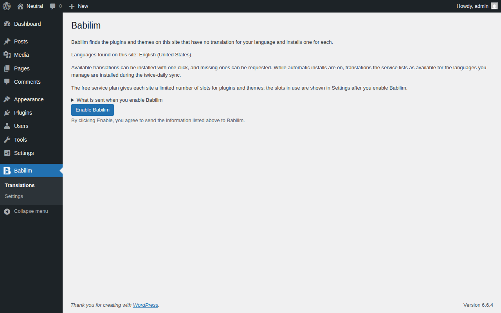
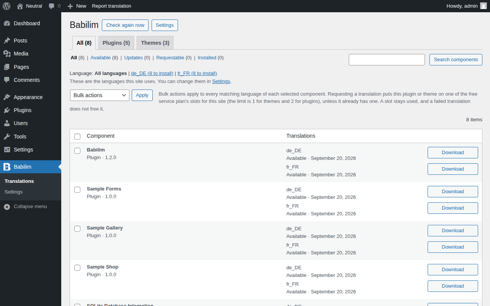
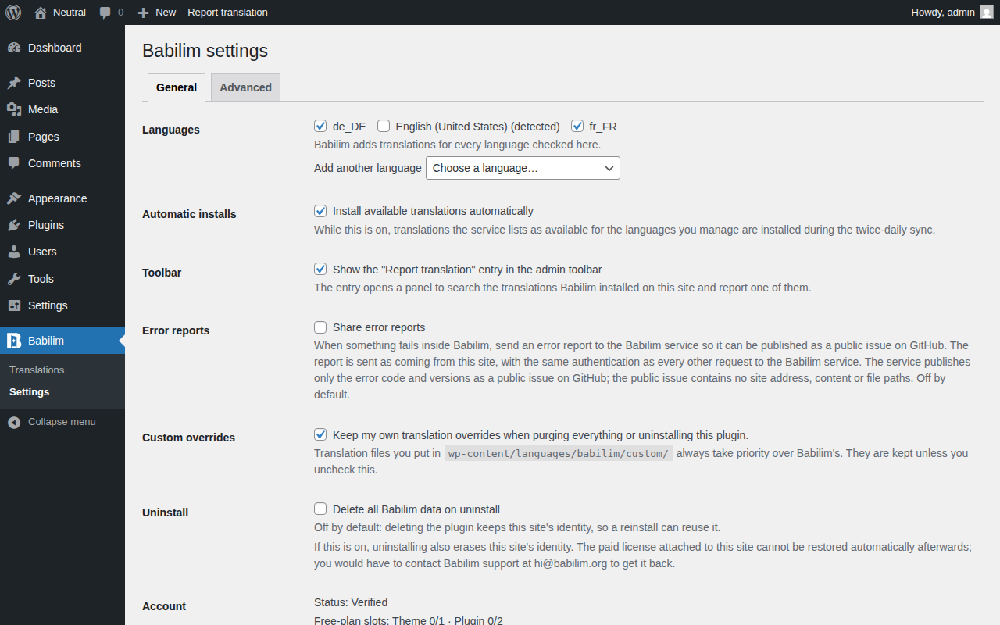

#  Babilim

Fills in missing translations for the plugins and themes already installed on your site.

Babilim is a WordPress plugin. It looks at what is installed, finds the plugins and themes that have no translation for your site's language, and lets you install or request one from the Babilim translation service.

## Install

1. Upload the plugin to `/wp-content/plugins/babilim`, or install it from the WordPress plugin directory: https://wordpress.org/plugins/babilim/
2. Activate it on the Plugins screen. Activation sends nothing.
3. Open **Babilim > Translations**, read the list of information that will be sent, and press **Enable Babilim** if you agree.
4. Components with a missing translation appear on the Translations screen. Install or request a translation there. Choose the languages to manage under **Babilim > Settings**.

Requires WordPress 6.6 or later and PHP 7.4 or later.

## How it works

* Before you agree, the plugin makes no request at all, not even on activation.
* After you enable it, it lists your installed plugins and themes and the languages in use on the site.
* The Translations screen shows each component's status per language. A translation that exists can be installed with one click. One that does not exist yet can be requested. A component that ships its own translation can still be offered a Babilim translation.
* Loading order for a plugin's or theme's own text domain: your override in `custom/` first, then a translation Babilim provides, then an official WordPress.org language pack or the component's own bundled translation.
* For WordPress core's `default` text domain, core's official translation always comes first, and Babilim only supplies strings core does not have.
* Babilim downloads translation data only (`.po`, `.mo`, `.json`). It never downloads or runs remote PHP or JavaScript.
* It writes only inside `wp-content/languages/babilim/`, apart from a temporary zip for a source upload you confirm.

Every WordPress language is supported on equal footing. The language list comes from the WordPress.org locale registry.

## Pricing

* Each site domain can use the service for one theme and two plugins listed on WordPress.org at no charge.
* Components not listed on WordPress.org, and anything beyond that allowance, need a one-time license for each site domain.
* The current price is shown on the Settings screen. Payment is handled by Paddle, the merchant of record. Refunds: https://babilim.org/refund/
* The allowance is decided by the service and may change. The plugin contains no limit logic of its own and only shows what the service reports.
* Translation files you already downloaded keep working regardless of the license.

## Screenshots

1. The Translations screen before you enable Babilim: what will be sent, and the Enable button.

2. The Translations screen after enabling: each installed plugin and theme with its translation status per language.

3. Settings: the languages to manage and the uninstall choices.

## FAQ

**Does the plugin contact any server before I agree?**
No. Nothing is sent until you press Enable Babilim.

**What is sent?**
Your site URL, WordPress, PHP and plugin versions, your locales, and a list of installed plugins and themes. The full list is shown above the Enable button and in the plugin's directory page.

**Does it change my site's files?**
No. It writes translation data files into `wp-content/languages/babilim/` only.

**Which languages can I use?**
Every locale WordPress supports.

**What if the service is unreachable?**
Installed translations keep working because they are ordinary local files. The plugin retries later.

The full FAQ is on the plugin page: https://wordpress.org/plugins/babilim/

## Reporting a problem

* A wrong translation: use **Report a problem** inside the plugin.
* A bug or a feature request: open an issue at https://github.com/babilim-org/babilim/issues (there are templates).
* General questions: the support forum at https://wordpress.org/support/plugin/babilim/
* Security, license or billing matters: write to hi@babilim.org

## Links

* Terms of Service: https://babilim.org/terms/
* Privacy Policy: https://babilim.org/privacy/
* Refund Policy: https://babilim.org/refund/

## License

GPL-2.0-or-later. See `LICENSE`.

## Development

See `docs/development.md`.
